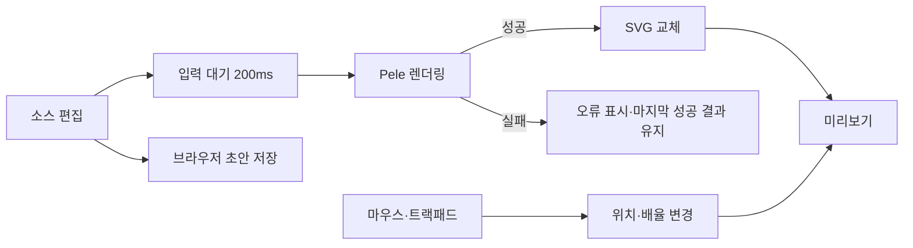

# ADR 001: React와 Pele 기반 다이어그램 작업 화면

스타일과 소스 배치 결정은 [ADR 002](002-shadcn-ui-and-source-structure.md)에 따라 shadcn/ui와 역할별 폴더로 변경했다. 아래 내용은 최초 결정의 배경을 보존하며, 편집·렌더링·줌·이동과 배포 결정은 계속 적용한다.

후속 요청으로 [ADR 003](003-codemirror-source-editor.md)의 편집기·패널 조절과 PNG 다운로드를 추가했다. PNG는 클릭 시점의 성공한 Pele SVG 전체를 브라우저의 Canvas로 변환하며 카메라 변환은 포함하지 않는다. 흰 배경·기본 2배 해상도를 사용하되 긴 변은 최대 4,096px로 제한한다. SVG를 읽는 object URL은 변환 후 해제하고 다운로드 URL은 브라우저가 파일을 읽을 시간을 둔 뒤 해제한다. 별도 이미지 처리 라이브러리나 서버 전송은 추가하지 않는다. [Canvas PNG 인코딩](https://developer.mozilla.org/en-US/docs/Web/API/HTMLCanvasElement/toBlob)

Mermaid 입력을 Pele로 렌더링하고 자유롭게 탐색하는 React SPA를 구현한다. 단순한 구조를 유지하기 위해 브라우저에서 편집과 렌더링을 처리하고, 화면 위치와 배율만 별도로 관리한다. 이 문서는 구현 기준으로 채택한 결정이며, 패키지 버전과 공식 문서는 2026-10-29를 기준으로 조사했다. 실제 실행 검증 결과는 README와 테스트에 기록한다.

## 방향

**React + Vite + TypeScript + TanStack Router로 작은 SPA를 만들고, Bun으로 의존성과 명령을 관리한다.** Mermaid 소스를 Pele로 SVG로 변환하며, SVG를 자유롭게 확대·축소하고 이동할 수 있는 미리보기를 제공한다. 배포 대상은 Cloudflare Workers Static Assets로 정한다.

첫 버전에서 중요한 것은 입력과 미리보기의 연결, 오류가 있어도 이어지는 편집, 편안한 마우스·트랙패드 조작이다. 스타일은 Pele의 기본값과 최소한의 앱 CSS로 시작한다. 재사용할 상황이 생기기 전에는 렌더러 인터페이스, 플러그인 구조, 공용 상태 관리 계층을 만들지 않는다. 작은 중복은 허용한다.

## 기술 선택

| 영역           | 선택                                  | 이유와 범위                                                                                              |
| -------------- | ------------------------------------- | -------------------------------------------------------------------------------------------------------- |
| 화면           | React + TypeScript                    | 브라우저에서 편집과 렌더링을 처리한다.                                                                   |
| 개발 서버·빌드 | Vite 8 + `@vitejs/plugin-react` 6     | 기본 Oxc/Rolldown 경로와 React Fast Refresh를 사용한다.                                                  |
| 라우터         | `@tanstack/react-router`              | TypeScript 지원과 커뮤니티 평가를 고려하되 코드 기반 라우트 하나로 시작한다.                             |
| 다이어그램     | `pele`                                | Mermaid 입력을 SVG로 렌더링한다. Mermaid.js를 중복 설치하지 않는다.                                      |
| 입력 편집기    | 기본 `textarea`                       | 붙여넣기, 선택, 실행 취소, 한글 입력을 브라우저에 맡긴다. 구문 강조가 필요해지면 편집기 도입을 검토한다. |
| 확대·이동      | Pointer/Wheel 이벤트 + 작은 React 훅  | 위치와 배율만 관리하며 SVG 내부의 노드나 레이아웃을 수정하지 않는다.                                     |
| 스타일         | 일반 CSS + Pele 기본 스타일           | 초기에는 테마 설정 화면과 UI 프레임워크를 추가하지 않는다.                                               |
| 패키지 매니저  | Bun                                   | `bun.lock`과 Bun 버전을 고정한다.                                                                        |
| 린트·포맷      | Oxlint + Oxfmt                        | Oxc 도구를 역할별로 연결한다.                                                                            |
| 타입 검사      | TypeScript 7의 Go 기반 `tsc --noEmit` | `tsrs`의 안정판을 기다리고, 사용자가 대안으로 지정한 tsgo 계열을 선택한다.                               |
| 배포           | Cloudflare Workers Static Assets      | Vite의 `dist/`를 배포하며 첫 버전에는 Worker 서버 코드를 만들지 않는다.                                  |
| 검증           | Bun test + Playwright                 | 좌표 계산은 단위 테스트로, 입력·렌더링·브라우저 이벤트는 E2E로 확인한다.                                 |

### TanStack Router를 선택하는 이유

React Router도 충분히 좋은 선택이다. 2025 State of React 조사에서는 응답자의 72.2%가 사용 경험을 보고했다. TanStack Router는 2024 조사에 실린 커뮤니티 추천에서 타입 안전성과 search parameter 설계로 긍정적인 평가를 받았고, 현재도 유지보수되고 있다. 이 자료만으로 어느 쪽의 만족도가 더 높다고 단정하지 않는다. Inklava에서는 TypeScript 중심의 개발 경험을 선택 근거로 삼는다. [2025 조사](https://2025.stateofreact.com/en-US/libraries/), [2024 커뮤니티 추천](https://2024.stateofreact.com/en-US/libraries/), [TanStack Router 개요](https://tanstack.com/router/latest/docs/overview)

초기 경로는 `/` 하나다. `router.tsx`에서 root와 index route, 찾을 수 없는 경로의 안내만 정의한다. 파일 라우트 생성 플러그인, loader, 서버 함수, TanStack Query는 지금 필요하지 않다. 소스와 화면 배율은 URL에 넣지 않는다. TanStack Router는 코드 기반 설정을 공식 지원한다. [수동 설정](https://tanstack.com/router/latest/docs/installation/manual)

사용자가 언급한 Remix 계열 대안은 React Router의 현재 모드 구분을 기준으로 검토했다. Declarative 모드는 단순 라우팅에 적합하고 Framework 모드는 Vite 통합과 여러 렌더링 방식을 제공한다. 이번 앱에는 서버 렌더링 요구가 없어 TanStack Start나 React Router Framework Mode까지 도입할 이유가 없다. [React Router 모드](https://reactrouter.com/start/modes)

### tsrs와 Oxc 통합

`tsrs`는 사용자가 연결한 Cloudflare/Oxc의 Rust 포트다. 공식 README는 TypeScript 7.1에 대한 완전한 호환성을 갖춘 안정판을 목표로 명시하고 있으므로, 첫 버전의 필수 타입 검사기로 채택하지 않는다. 사용자의 대안 요청에 따라 Go 기반 네이티브 컴파일러를 선택한다. 현재는 TypeScript 7 안정판의 `typescript` 패키지와 `tsc` 명령으로 제공되므로, 과거 미리보기의 `tsgo` 패키지 경로를 새로 추가할 필요가 없다. [tsrs](https://github.com/oxc-project/tsrs), [TypeScript 7 공식 발표](https://devblogs.microsoft.com/typescript/announcing-typescript-7-0/)

Vite 8이 Oxc 변환과 Rolldown 번들을 제공하고 React 플러그인 6도 Oxc 기반 Fast Refresh를 사용한다. 별도 `oxc-parser`나 폐기된 `@vitejs/plugin-react-oxc`를 넣지 않는다. Oxc parser는 JS/TS 소스용이며 Mermaid 파싱은 Pele의 책임이다. 타입 검사는 빌드와 분리한다. [Vite 8 발표](https://vite.dev/blog/announcing-vite8), [Oxc Parser](https://oxc.rs/docs/guide/usage/parser)

Oxlint의 기본 오류 검사와 React·Hooks·접근성 규칙, `oxlint-tsgolint`의 타입 기반 검사를 사용한다. Oxfmt는 기본 스타일을 적용한다. Oxfmt는 아직 beta이므로 버전을 고정하고 업데이트 시 포맷 변경을 검토한다. 구체적인 설정, 예상 스크립트, Vite+를 포함한 비교는 [개발 도구 조사](../research/tooling.md)에 둔다.

## 화면과 첫 버전의 범위

데스크톱에서는 왼쪽에 소스, 오른쪽에 미리보기를 배치한다. 미리보기 상단에는 배율 표시와 `−`, `+`, `100%`, `화면에 맞춤` 버튼을 둔다. 소스 영역에는 오류 메시지를 표시할 자리를 확보한다. 초기 비율은 소스 약 35%, 미리보기 약 65%로 두고, 좁은 화면에서는 위아래로 쌓는다. 패널 크기 조절 기능은 처음부터 추가하지 않는다.

첫 방문에는 짧은 flowchart 예시를 제공한다. 입력한 소스는 브라우저에 초안 하나로 저장해 새로고침 후 복원한다. 비어 있는 문자열도 사용자의 초안이므로 예시로 덮어쓰지 않는다. 저장소 접근이 차단되거나 용량이 부족하면 편집은 계속 제공하고 저장 실패만 알린다. 서버 저장, 계정, 공유 URL, 협업, 이미지 내보내기, 노드 직접 편집은 후속 범위다.



줌과 이동은 렌더링을 다시 실행하지 않는다. 소스가 바뀔 때만 SVG를 새로 만들고, 화면 탐색은 이미 만들어진 SVG의 바깥 요소를 이동·확대한다.

## Pele 렌더링

초기에는 `pele`의 동기식 `render()`를 직접 사용한다. 비동기 lazy loading, 자체 Mermaid AST, 렌더러 교체용 인터페이스는 추가하지 않는다. 실제 번들 크기가 문제가 되면 Pele의 lazy entry point를 검토한다. [Pele API](https://pele.run/api)

`renderDiagram.ts` 한 곳에서 다음 옵션을 지정한다. 아래는 예정된 호출 형태다.

```ts
render(source, {
  responsive: false,
  autoDirection: false,
  idPrefix: "inklava-preview-",
  links: false,
  images: false,
});
```

미리보기 크기가 바뀌어도 소스의 방향과 자연 크기를 유지한다. `maxWidth`를 넘겨 레이아웃을 다시 맞추지 않으며, 결과의 `width`·`height`로 화면 맞춤 배율을 계산한다. 다이어그램 하나만 표시하므로 고정된 ID prefix면 충분하다. 색상·폰트는 기본값을 유지하고 나중에 `.diagram-preview` 아래에서 Pele CSS 변수를 조정한다. [Pele 테마](https://pele.run/theming)

입력 처리와 화면 상태는 다음처럼 정한다.

1. 입력 즉시 소스를 갱신하고 200ms 동안 추가 입력이 없으면 렌더링한다. 한글 조합 중에는 실행하지 않고 조합 종료 후 예약한다.
2. 성공하면 SVG와 자연 크기를 함께 교체하고 오류를 지운다. 첫 성공 때만 화면에 맞춘다.
3. 입력 도중의 문법 오류에서는 마지막 성공 SVG와 화면 위치를 유지한다. 미리보기에는 현재 입력과 다른 결과임을 표시한다.
4. 처음부터 오류이면 비어 있는 미리보기와 오류 안내를 표시한다. 소스를 전부 지우면 마지막 결과도 비우고 입력 안내로 돌아간다.
5. 알려진 Pele 오류는 메시지와 제공되는 위치를 보여주고, 예상하지 못한 오류도 편집 화면을 무너뜨리지 않게 처리한다. 예약된 작업은 입력 변경과 unmount 때 정리한다.

Pele는 Mermaid 문법을 해석하지만 Mermaid.js와 레이아웃·스타일이 동일하지 않다. 공식 호환성 문서가 지원하는 내장 타입을 범위로 삼고 외부 Mermaid 플러그인까지 지원한다고 안내하지 않는다. 별도 Mermaid.js fallback도 두지 않는다. [호환성](https://pele.run/compatibility)

SVG 삽입은 Pele 출력에만 허용하고, 원문과 오류는 React 텍스트로 표시한다. 초기에는 링크·외부 이미지를 꺼서 미리보기에서 의도하지 않은 이동이나 외부 요청이 일어나지 않게 한다. 임의의 icon/math markup 콜백을 받지 않으며 렌더 옵션은 앱 코드가 소유한다. Pele의 기본 소스·출력·edge 제한을 유지한다. 이 제한은 실행 시간 제한이 아니므로 큰 입력의 지연은 별도로 측정해야 한다. [보안과 제한](https://pele.run/security)

## 줌과 이동

### Pele 내장 줌을 그대로 사용하지 않는 이유

Pele의 `enableZoom()`은 문서 안의 다이어그램을 확대해서 읽는 데 적합하다. 다만 현재 구현은 최소 배율이 화면 맞춤 배율이고 이동 범위도 그림 경계로 제한된다. 일반 wheel은 페이지 스크롤로 남겨두며 SVG 교체 후 refresh는 줌을 초기화한다. 이번 요구에서는 축소한 그림 주위의 빈 공간을 자유롭게 이동하고 편집 중에도 시점을 유지해야 하므로, Pele는 렌더링에만 사용한다. 내장 줌과 앱 이벤트를 동시에 켜지 않는다. [Pele 줌 구현](https://github.com/obsidianmd/pele/blob/main/src/zoom.ts)

React Flow나 별도의 캔버스 편집 프레임워크도 필요하지 않다. 노드를 편집하는 앱이 아니라 SVG 한 장을 탐색하는 앱이므로, `useViewport.ts`가 이벤트와 `{ x, y, scale }`만 관리한다. 제스처 라이브러리 수준의 범용 API로 확장하지 않는다.

### 조작 규칙

| 입력                                         | 동작                                      |
| -------------------------------------------- | ----------------------------------------- |
| 트랙패드 두 손가락 스크롤                    | 가로·세로 이동                            |
| 트랙패드 핀치                                | 포인터 위치를 기준으로 확대·축소          |
| 마우스 wheel                                 | 세로 이동, Shift + wheel은 가로 이동      |
| Ctrl 또는 Cmd + wheel                        | 포인터 위치를 기준으로 확대·축소          |
| 미리보기 드래그                              | 이동; 왼쪽 버튼과 가운데 버튼을 지원한다. |
| `−` / `+` 버튼                               | 화면 중심을 기준으로 축소·확대            |
| `100%`                                       | 화면 중심을 유지하며 자연 크기로 표시     |
| `화면에 맞춤`                                | 그림 전체가 보이도록 가운데 배치          |
| 미리보기 포커스 상태의 `+`, `−`, `0`, 방향키 | 확대·축소, 화면 맞춤, 이동                |

마우스와 트랙패드를 wheel delta 크기로 추측하지 않는다. 기본 wheel은 이동, modifier가 있는 wheel은 줌으로 일관되게 처리한다. 도움말에 이 규칙을 짧게 표시한다. Chromium 계열의 핀치는 보통 Ctrl이 설정된 wheel로 전달되며, Safari는 별도의 gesture 이벤트를 처리해야 한다. Safari gesture 처리 중에는 같은 제스처의 wheel 줌을 중복 반영하지 않는다. [Wheel 이벤트](https://developer.mozilla.org/en-US/docs/Web/API/Element/wheel_event), [GestureEvent](https://developer.mozilla.org/en-US/docs/Web/API/GestureEvent)

### 위치 계산과 이벤트 경계

미리보기는 `overflow: hidden`인 고정 영역이며 내부 SVG의 바깥 요소에 `translate(x, y) scale(scale)`을 적용한다. 변환 원점은 왼쪽 위다. 줌 중에도 포인터 아래의 다이어그램 좌표가 유지되어야 한다.

```text
worldX = (pointerX - x) / scale
worldY = (pointerY - y) / scale
nextX = pointerX - worldX * nextScale
nextY = pointerY - worldY * nextScale
```

포인터 좌표는 미리보기의 bounding rect를 빼서 구한다. 기본 배율 범위는 5%~800%로 잡되, 큰 그림의 전체 맞춤이 가능하도록 최소 배율은 `min(0.05, fitScale)`로 낮춘다. 화면 맞춤은 사방 32px 여백을 제외한 영역과 그림의 가로·세로 비율 중 작은 값을 사용하고, 작은 그림은 100%를 넘겨 자동 확대하지 않는다. 영역 또는 그림의 크기가 0이면 계산을 보류한다.

이동 범위를 그림 경계로 제한하지 않는다. 그림을 화면 밖으로 옮긴 경우에도 `화면에 맞춤`으로 복귀할 수 있다. 소스 수정 후에는 현재 위치와 배율을 유지한다. 창 크기가 바뀌면 배율과 화면 중심에 있던 그림 좌표를 유지하며, 사용자가 직접 맞춤을 누르기 전까지 자동으로 다시 맞추지 않는다.

wheel 이벤트는 미리보기 표면에만 `{ passive: false }`로 등록한다. `deltaMode`의 pixel·line·page 차이를 정규화하고, 줌은 연속 배율 계산과 상한·하한을 적용한다. 툴바와 편집 영역의 스크롤·키 입력은 가로채지 않는다. 전체 문서에 페이지 줌 방지 핸들러를 두지 않는다.

드래그 시작 시 pointer capture를 사용하고 `pointerup`, `pointercancel`, `lostpointercapture`, window blur에서 종료한다. 터치스크린 이벤트까지 받는 경우에는 포인터 한 개만 활성 드래그로 처리한다. 터치스크린 멀티터치 편집은 첫 버전의 검증 범위에서 제외한다. [Pointer capture](https://developer.mozilla.org/en-US/docs/Web/API/Element/setPointerCapture)

고빈도 이벤트는 ref에 최신 위치를 모으고 `requestAnimationFrame`당 한 번 변환을 적용한다. 소스 편집 컴포넌트는 이동 때문에 다시 렌더링하지 않는다. DOM 변환과 배율 표시는 같은 위치 값에서 갱신하고, unmount 때 listener·observer·animation frame을 모두 정리한다. 위치 계산 함수만 단위 테스트를 위해 분리한다.

## 코드와 상태의 배치

아래는 구현 시 만들 파일의 출발점이다. 실제 코드가 짧으면 인접 파일에 합쳐도 되며, 빈 디렉터리나 재사용 전용 계층을 미리 만들지 않는다.

```text
src/
  main.tsx
  router.tsx
  Workbench.tsx
  SourceEditor.tsx
  DiagramPreview.tsx
  renderDiagram.ts
  useViewport.ts
  viewport.ts
  styles.css
```

`Workbench`는 소스, 마지막 성공 결과, 오류와 초안 저장을 소유한다. `SourceEditor`는 입력과 오류를 표시한다. `DiagramPreview`는 SVG와 도구 모음을 표시하며 `useViewport`로 화면 위치를 관리한다. `viewport.ts`에는 포인터 중심 줌과 화면 맞춤의 순수 계산만 둔다. SVG 전체 문자열은 초안 저장 대상이 아니다.

초안은 `localStorage`의 `inklava:source` 키 하나에 원문 문자열로 저장한다. 입력 후 짧게 지연해 저장하고, 정상적인 페이지 이탈 시 최신 입력도 반영한다. 저장 계층, 문서 ID, migration framework는 만들지 않는다. 다른 탭과 실시간 동기화하지 않으며 마지막 저장값이 다음 방문의 초안이 된다.

## Cloudflare 배포

첫 버전은 브라우저에서 모든 작업을 처리하므로 Workers Static Assets로 `dist/`만 제공한다. 서버 `fetch` handler나 `ASSETS.fetch()` 프록시를 추가할 필요가 없다. 개발은 Vite로, 빌드 결과의 배포 경로 확인은 Wrangler로 수행한다. API나 Cloudflare binding이 실제로 필요해지면 그때 Cloudflare Vite 플러그인과 Worker 코드를 도입한다. [Static Assets 시작하기](https://developers.cloudflare.com/workers/static-assets/get-started/)

`wrangler.jsonc`의 핵심 설정은 다음과 같다. `main`은 지정하지 않는다.

```jsonc
{
  "$schema": "node_modules/wrangler/config-schema.json",
  "name": "inklava",
  "compatibility_date": "2026-10-29",
  "assets": {
    "directory": "./dist",
    "not_found_handling": "single-page-application",
  },
}
```

SPA navigation의 fallback을 켜서 주소 직접 진입과 새로고침을 처리한다. 실제로 없는 경로는 클라이언트 라우터가 안내한다. 실제 JS·CSS 자산의 응답도 확인한다. 구현 중 Wrangler 4.155.0 로컬 서버에서 **없는 `/assets/missing.js`에도 `index.html`이 200으로 응답**하는 것을 확인했다. 공식 상세 설명에서도 `single-page-application`은 모든 미일치 요청을 `index.html`로 돌린다. 정적 자산만 배포한다는 결정을 유지하며 이 동작을 현재 제약으로 기록한다. 없는 자산의 404 구분이 필요해지면 Worker 경로 처리를 별도 결정한다. 로컬 결과가 실제 프로덕션 배포 검증을 대신하지는 않는다. [Cloudflare SPA 라우팅](https://developers.cloudflare.com/workers/static-assets/routing/single-page-application/)

Bun은 패키지 매니저와 명령 실행 진입점이다. 배포되는 브라우저 코드는 Bun 런타임을 사용하지 않는다. Node 24.18.0과 Bun 1.4.0에서 실행을 확인했다. 배포 명령은 `bun run build` → 로컬 Wrangler 확인 → `bun run deploy` 순서로 준비했다. 실제 외부 배포는 별도 요청이 있을 때 수행한다.

## 구현 순서와 완료 기준

1. **개발 환경:** React/Vite/Bun과 단일 라우트를 구성한다. Oxlint·Oxfmt·타입 검사·빌드 명령을 연결하고 실제 호환성을 확인한다. 설정과 실행 방법은 README에 기록한다.
2. **편집과 렌더링:** 예시, 소스 입력, Pele 기본 SVG, 오류와 마지막 성공 결과 유지, 한글 조합, 초안 복원을 완성한다. 이 단계에서부터 입력부터 표시까지 연결된 앱을 실행할 수 있어야 한다.
3. **화면 탐색:** 포인터 중심 줌, 자유 이동, 맞춤, 100%, 배율 표시, 키보드 조작, 수정·resize 후 시점 유지를 구현한다.
4. **브라우저 확인과 배포 준비:** 아래 동작 검증을 통과시키고 Wrangler에서 정적 산출물과 경로를 확인한다. 실제 배포 주소와 계정 설정은 배포 작업 시 확정한다.

테스트는 구현을 그대로 복제하지 않고 사용자에게 중요한 경계를 확인한다.

| 검증             | 완료 기준                                                                                                                             |
| ---------------- | ------------------------------------------------------------------------------------------------------------------------------------- |
| 좌표 단위 테스트 | 포인터 중심 줌의 고정점, 배율 제한, 가로·세로 맞춤, 크기 0, resize 중심 유지가 맞는다.                                                |
| 입력 E2E         | flowchart·sequence·ER 입력이 표시되고, 오류 후 수정하면 복구된다. 빈 입력과 초안 복원도 동작한다.                                     |
| 상태 유지 E2E    | 오류 중 마지막 성공 결과가 남고, 정상 편집 후 줌·이동 값이 초기화되지 않는다.                                                         |
| 제스처 E2E       | wheel 이동, modifier 줌, 드래그, 맞춤이 작동하며 편집 영역 wheel에는 영향을 주지 않는다.                                              |
| 실제 장치 확인   | macOS Chrome·Safari 트랙패드 핀치와 관성 스크롤, 일반 마우스 wheel을 확인한다. 합성 이벤트만으로 편안함을 검증했다고 판단하지 않는다. |
| 접근성·한글      | 입력 라벨, 버튼 이름, 포커스 표시, 키보드 대체 조작, 한글 조합 중단 없는 입력을 확인한다.                                             |
| 정리·배포        | React Strict Mode 재마운트에도 이벤트가 중복되지 않고, 정적 빌드의 진입·새로고침·없는 경로가 의도대로 처리된다.                       |

200ms debounce와 5%~800% 배율은 초기 UX 값이다. 렌더링 시간과 입력 지연은 실제 기기에서 측정한다. 중간 크기 예시와 제한에 가까운 큰 입력을 비교하고, 동기 렌더링이 반복적으로 긴 main-thread 작업을 만들면 브라우저 Web Worker로 옮기는 후속 작업을 잡는다. 단순히 Promise로 감싸는 것으로 CPU 작업이 분리되지는 않는다. Web Worker는 Cloudflare Worker와 다른 개념이며, 도입 시 폰트 측정 차이와 취소·시간 제한을 함께 해결해야 한다.

## 조사로 확인한 범위와 남은 검증

Pele `1.12.0`과 TanStack Router `1.170.46`은 각각 2026-10-26과 2026-10-22 배포를 npm 레지스트리에서 확인했다. Pele는 Obsidian 조직의 MIT 프로젝트이며 공개 저장소에 수백 건의 커밋과 사용 관심이 확인된다. 라우터의 채택 평가는 위 설문 자료를 참고했다. 최근 배포와 커뮤니티 평가는 의존성 선택의 근거이며, 이 앱의 호환성이나 성능을 보증하는 자료는 아니다. [Pele 패키지](https://registry.npmjs.org/pele), [Router 패키지](https://registry.npmjs.org/@tanstack/react-router), [Pele 저장소](https://github.com/obsidianmd/pele)

도구의 정확한 설치 조합은 `package.json`과 `bun.lock`에 고정했다. 좌표 계산은 Bun test로, 입력·저장·제스처·시점 유지는 Chromium·Firefox·WebKit의 Playwright E2E로 확인한다. 전체 Pele entry의 빌드 결과는 JS 약 1.00MB, gzip 356KB이며 Vite 청크 경고가 발생한다. 실제 macOS Safari·트랙패드 감도와 대형 다이어그램 렌더링 지연은 아직 물리 장치에서 검증하지 않았다. 합성 이벤트 검증을 실제 조작감이나 성능의 증거로 확대하지 않는다. 스타일 변경은 기본 동작 검증 이후 진행하며, 폰트를 바꿀 때에는 글자 측정과 SVG 재렌더링도 함께 검토한다.
