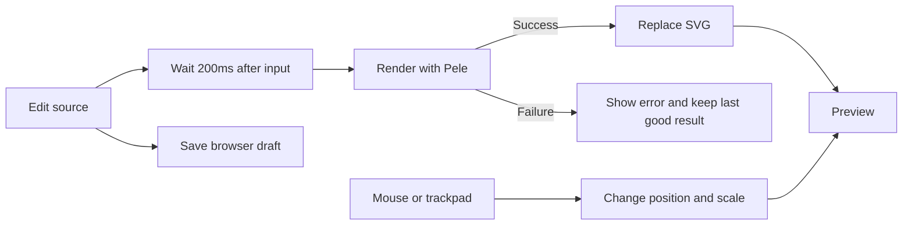

# ADR 001: React and Pele diagram workbench

[ADR 002](002-shadcn-ui-and-source-structure.md) supersedes the styling and source layout choices with shadcn/ui and folders organized by role. This document preserves the original rationale; the editing, rendering, pan and zoom, and deployment decisions still apply.

Later requests added the editor and panel resizing described in [ADR 003](003-codemirror-source-editor.md), plus PNG downloads. PNG export converts the entire successful Pele SVG captured at click time through browser Canvas, excluding the camera transform. It uses a white background and twice the natural resolution, capped at 4,096px on the longest edge. Release the SVG object URL after conversion and the download URL after allowing the browser time to read it. Add neither an image-processing library nor server uploads. [Canvas PNG encoding](https://developer.mozilla.org/en-US/docs/Web/API/HTMLCanvasElement/toBlob)

Build a React SPA that renders Mermaid input with Pele and lets users explore diagrams freely. Keep editing and rendering in the browser, with a separate position and scale state. This is an accepted implementation decision based on package and documentation research dated 2026-10-29. Execution results are documented in the [development guide](../development.md) and tests.

## Direction

**Build a small SPA with React, Vite, TypeScript, and TanStack Router, using Bun for dependencies and scripts.** Convert Mermaid source to SVG with Pele and provide free pan and zoom. Target Cloudflare Workers Static Assets for deployment.

The first version prioritizes the input-to-preview flow, uninterrupted editing through errors, and comfortable mouse and trackpad controls. Start with Pele's default styles and minimal app CSS. Introduce renderer interfaces, plugins, or shared state layers only when there is a concrete reuse need. Small amounts of duplication are acceptable.

## Technology choices

| Area                 | Choice                                    | Rationale and scope                                                                                                        |
| -------------------- | ----------------------------------------- | -------------------------------------------------------------------------------------------------------------------------- |
| UI                   | React + TypeScript                        | Edit and render in the browser.                                                                                            |
| Dev server and build | Vite 8 + `@vitejs/plugin-react` 6         | Use the default Oxc/Rolldown pipeline and React Fast Refresh.                                                              |
| Router               | `@tanstack/react-router`                  | Favor TypeScript support and community feedback; start with one code-based route.                                          |
| Diagrams             | `pele`                                    | Render Mermaid input to SVG without also installing Mermaid.js.                                                            |
| Source editor        | Native `textarea`                         | Initially delegate paste, selection, undo, and Korean input to the browser; reconsider when syntax highlighting is needed. |
| Pan and zoom         | Pointer/Wheel events + a small React hook | Manage position and scale without editing SVG nodes or layout.                                                             |
| Styling              | Plain CSS + Pele defaults                 | Initially omit theme settings and a UI framework.                                                                          |
| Package manager      | Bun                                       | Pin Bun and `bun.lock`.                                                                                                    |
| Lint and formatting  | Oxlint + Oxfmt                            | Use each Oxc tool for its specific role.                                                                                   |
| Type checking        | TypeScript 7's Go-based `tsc --noEmit`    | Wait for stable tsrs and use the tsgo family requested as the fallback.                                                    |
| Deployment           | Cloudflare Workers Static Assets          | Deploy Vite's `dist/` without Worker server code in the first version.                                                     |
| Verification         | Bun test + Playwright                     | Unit-test coordinates; use E2E tests for input, rendering, and browser events.                                             |

### Why TanStack Router

React Router is also a sound choice: 72.2% of respondents in the 2025 State of React survey reported having used it. Community recommendations in the 2024 survey praised TanStack Router's type safety and search-parameter design, and the project remained maintained at the time of research. These sources do not establish that one router has higher overall satisfaction. Inklava chooses TanStack Router for its TypeScript-focused development experience. [2025 survey](https://2025.stateofreact.com/en-US/libraries/), [2024 community recommendations](https://2024.stateofreact.com/en-US/libraries/), [TanStack Router overview](https://tanstack.com/router/latest/docs/overview)

Start with `/` only. Define the root, index route, and not-found message in `router.tsx`. File-route generation, loaders, server functions, and TanStack Query are unnecessary at this stage. Keep source and zoom out of the URL. TanStack Router officially supports code-based configuration. [Manual setup](https://tanstack.com/router/latest/docs/installation/manual)

Evaluate the requested Remix-related alternative through React Router's current modes. Declarative mode suits simple routing; Framework mode adds Vite integration and multiple rendering strategies. This app does not require server rendering, so neither TanStack Start nor React Router Framework mode is needed. [React Router modes](https://reactrouter.com/start/modes)

### tsrs and Oxc integration

The requested `tsrs` is Cloudflare/Oxc's Rust port. Its README describes a stable release with full TypeScript 7.1 compatibility as a goal, so it is not the first version's required type checker. Use the Go-based native compiler as requested. It is available through the stable TypeScript 7 `typescript` package and `tsc` command; no separate preview `tsgo` package path is needed. [tsrs](https://github.com/oxc-project/tsrs), [TypeScript 7 announcement](https://devblogs.microsoft.com/typescript/announcing-typescript-7-0/)

Vite 8 supplies Oxc transforms and Rolldown bundling; React plugin 6 also uses Oxc for Fast Refresh. Do not add `oxc-parser` or the deprecated `@vitejs/plugin-react-oxc`. Oxc parses JS/TS; Pele parses Mermaid. Keep type checking separate from building. [Vite 8 announcement](https://vite.dev/blog/announcing-vite8), [Oxc Parser](https://oxc.rs/docs/guide/usage/parser)

Use Oxlint correctness, React, Hooks, and accessibility rules with `oxlint-tsgolint` for type-aware checks. Apply Oxfmt defaults. Oxfmt is still beta at the research date, so pin its version and review formatting changes on upgrades. See [tooling research](../research/tooling.md) for configuration, scripts, and the Vite+ comparison.

## Initial screen and scope

On desktop, place source on the left and preview on the right. The preview toolbar has a zoom indicator and `−`, `+`, `100%`, and `Fit to view` buttons. Reserve source feedback space for errors. Start with roughly 35% source and 65% preview, stacked vertically on narrow screens. Panel resizing was outside the original scope and was added later.

Show a short flowchart on first visit. Store one draft in the browser and restore it after reload, including an intentionally empty string. If storage is blocked or full, continue editing and report only the storage failure. Server persistence, accounts, shareable URLs, collaboration, image exports, and direct node editing were deferred in the initial design; PNG export was subsequently added as noted above.



Pan and zoom do not rerender the diagram. Generate SVG only when source changes; navigation transforms an outer element around the existing SVG.

## Pele rendering

Initially call synchronous `render()` from `pele` directly. Do not add lazy loading, a custom Mermaid AST, or an interchangeable renderer interface. Reconsider Pele's lazy entry point if measured bundle size becomes a problem. [Pele API](https://pele.run/api)

Configure the following options in one rendering module, now `src/lib/render-diagram.ts`:

```ts
render(source, {
  responsive: false,
  autoDirection: false,
  idPrefix: "inklava-preview-",
  links: false,
  images: false,
});
```

Keep the source direction and natural dimensions when the preview resizes. Do not pass `maxWidth` to relayout the diagram; calculate fitting from the returned `width` and `height`. A fixed ID prefix is sufficient for one diagram. Keep default colors and fonts, with future adjustments scoped to Pele CSS variables under `.diagram-preview`. [Pele theming](https://pele.run/theming)

Input and preview state follow these rules:

1. Update source immediately. Render after 200ms without input, defer during IME composition, and reschedule after composition ends.
2. On success, replace the SVG and natural dimensions together and clear the error. Auto-fit only on the first success.
3. During syntax errors, preserve the last successful SVG and camera, with a visible indication that the preview differs from current input.
4. An initially invalid source shows an empty preview and error. Clearing all source also clears the last result and restores the input prompt.
5. Show known Pele error messages and available locations. Handle unexpected errors without breaking the editor. Clean up scheduled work on input changes and unmount.

Pele accepts Mermaid syntax but does not reproduce Mermaid.js layout or styling exactly. Support the built-in types in Pele's compatibility documentation, without claiming external Mermaid plugin support or adding a Mermaid.js fallback. [Compatibility](https://pele.run/compatibility)

Only Pele output may be inserted as SVG markup. Display source and errors as React text. Disable links and external images to avoid unintended navigation or requests. Do not accept arbitrary icon/math markup callbacks; render options belong to the app. Keep Pele's default source, output, and edge limits. These are not execution time limits, so measure latency for large input separately. [Security and limits](https://pele.run/security)

## Pan and zoom

### Why not Pele's built-in zoom

Pele's `enableZoom()` suits reading diagrams embedded in documents. Its implementation limits minimum zoom to the fit scale and panning to diagram bounds, leaves ordinary wheel events for page scrolling, and resets zoom when refreshed after SVG replacement. This app needs free movement through empty space around a zoomed-out diagram and camera preservation while editing. Use Pele for rendering only; do not enable its zoom alongside app event handling. [Pele zoom implementation](https://github.com/obsidianmd/pele/blob/main/src/zoom.ts)

React Flow or another canvas editing framework is unnecessary. The app explores one SVG rather than editing its nodes, so `use-viewport.ts` manages only events and `{ x, y, scale }`. Do not generalize it into a gesture-library API.

### Controls

| Input                                        | Action                                        |
| -------------------------------------------- | --------------------------------------------- |
| Two-finger trackpad scrolling                | Horizontal and vertical pan                   |
| Trackpad pinch                               | Zoom around the pointer                       |
| Mouse wheel                                  | Vertical pan; Shift + wheel pans horizontally |
| Ctrl or Cmd + wheel                          | Zoom around the pointer                       |
| Preview drag                                 | Pan with the left or middle button            |
| `−` / `+` buttons                            | Zoom around the view center                   |
| `100%`                                       | Natural size while preserving the view center |
| `Fit to view`                                | Center the entire diagram in view             |
| `+`, `−`, `0`, arrow keys with preview focus | Zoom, fit, and pan                            |

Do not infer mouse versus trackpad from wheel delta size. Ordinary wheel events pan; modifier-wheel events zoom. Document this rule briefly. Chromium pinch usually arrives as a wheel event with Ctrl set; Safari needs separate gesture handling. Suppress duplicate wheel zoom while a Safari gesture is active. [Wheel events](https://developer.mozilla.org/en-US/docs/Web/API/Element/wheel_event), [GestureEvent](https://developer.mozilla.org/en-US/docs/Web/API/GestureEvent)

### Coordinates and event boundaries

Use a fixed preview surface with `overflow: hidden`. Apply `translate(x, y) scale(scale)` to the SVG's outer element with a top-left transform origin. The diagram point beneath the pointer must stay fixed while zooming.

```text
worldX = (pointerX - x) / scale
worldY = (pointerY - y) / scale
nextX = pointerX - worldX * nextScale
nextY = pointerY - worldY * nextScale
```

Subtract the preview bounding rectangle to obtain local pointer coordinates. Start with a 5%–800% zoom range, lowering the minimum to `min(0.05, fitScale)` for very large diagrams. Fit using the smaller width/height ratio after reserving 32px padding on every side. Do not automatically enlarge small diagrams beyond 100%. Defer calculations when either the surface or diagram has zero dimensions.

Do not constrain panning to diagram bounds. `Fit to view` recovers offscreen diagrams. Preserve position and scale after source edits. On window resize, preserve scale and the diagram point at the view center instead of automatically fitting again.

Register wheel handling only on the preview surface with `{ passive: false }`. Normalize pixel, line, and page `deltaMode` values, and use continuous zoom with upper and lower limits. Do not intercept toolbar or editor scrolling and keyboard input, or add document-wide page-zoom prevention.

Capture the pointer when dragging starts and stop on `pointerup`, `pointercancel`, `lostpointercapture`, or window blur. Handle only one active drag pointer, including touchscreen events. Touchscreen multitouch editing is outside initial verification. [Pointer capture](https://developer.mozilla.org/en-US/docs/Web/API/Element/setPointerCapture)

Collect high-frequency updates in refs and apply transforms once per `requestAnimationFrame`. Panning should not rerender the source editor. Update the DOM transform and zoom display from the same camera value. Clean up listeners, observers, and animation frames on unmount. Extract only pure coordinate calculations for unit tests.

## Code and state organization

The following layout records the original design. [ADR 002](002-shadcn-ui-and-source-structure.md) now organizes files into `components/`, `hooks/`, and `lib/`, with kebab-case source filenames. Merge adjacent files if the implementation is short; do not create empty directories or speculative reuse layers.

```text
src/
  main.tsx
  router.tsx
  Workbench.tsx
  SourceEditor.tsx
  DiagramPreview.tsx
  renderDiagram.ts
  useViewport.ts
  viewport.ts
  styles.css
```

`Workbench` owns source, the last successful result, errors, and draft storage. `SourceEditor` displays input and errors. `DiagramPreview` displays SVG and controls and uses `useViewport` for camera behavior. `viewport.ts` contains pure pointer-centered zoom and fit calculations. Do not persist the entire SVG string as a draft.

Store raw source under one `localStorage` key, `inklava:source`. Save after a short input delay and capture the latest source on normal page exit. Do not add a storage layer, document IDs, or migrations. Tabs do not synchronize live; the last stored value becomes the next visit's draft.

## Cloudflare deployment

All initial work happens in the browser, so serve only `dist/` through Workers Static Assets. A server `fetch` handler or `ASSETS.fetch()` proxy is unnecessary. Use Vite for development and Wrangler to check built assets and routing. Introduce the Cloudflare Vite plugin and Worker code only when APIs or bindings are needed. [Static Assets setup](https://developers.cloudflare.com/workers/static-assets/get-started/)

The core `wrangler.jsonc` configuration has no `main`:

```jsonc
{
  "$schema": "node_modules/wrangler/config-schema.json",
  "name": "inklava",
  "compatibility_date": "2026-10-29",
  "assets": {
    "directory": "./dist",
    "not_found_handling": "single-page-application",
  },
}
```

Enable SPA fallback for direct navigation and reloads; the client router handles unknown routes. Verify actual JavaScript and CSS responses too. Local Wrangler 4.155.0 returned **`index.html` with status 200 even for nonexistent `/assets/missing.js`**. Official documentation likewise routes all unmatched requests to `index.html` in SPA mode. Retain assets-only deployment and record this limitation. Returning 404 for missing assets would need a separate Worker routing decision. Local results do not verify production deployment. [Cloudflare SPA routing](https://developers.cloudflare.com/workers/static-assets/routing/single-page-application/)

Bun manages packages and scripts; deployed browser code does not use the Bun runtime. Execution was verified with Node 24.18.0 and Bun 1.4.0. Prepare deployment as `bun run build`, local Wrangler verification, then `bun run deploy`. External deployment requires a separate request.

## Implementation order and completion criteria

1. **Tooling:** configure React, Vite, Bun, and one route. Connect Oxlint, Oxfmt, type checking, and build commands; verify compatibility and document setup.
2. **Editing and rendering:** complete the example, source input, default Pele SVG, error recovery, last-success preservation, composition handling, and draft restoration. The app must already work from input through preview.
3. **Navigation:** implement pointer-centered zoom, free pan, fit, 100%, zoom display, keyboard controls, and camera preservation after edits and resizes.
4. **Browser checks and deployment preparation:** pass the checks below and verify static output and routes with Wrangler. Confirm deployment URLs and account settings during deployment.

Test user-facing boundaries rather than duplicating implementation details.

| Verification                   | Completion criterion                                                                                                                  |
| ------------------------------ | ------------------------------------------------------------------------------------------------------------------------------------- |
| Coordinate unit tests          | Correct zoom anchor, scale limits, width/height fit, zero dimensions, and center preservation on resize.                              |
| Input E2E                      | Render flowchart, sequence, and ER input; recover from errors; handle empty input and restored drafts.                                |
| State E2E                      | Preserve the last good result during errors and the camera after valid edits.                                                         |
| Gesture E2E                    | Wheel pan, modifier zoom, drag, and fit work without affecting editor wheel behavior.                                                 |
| Physical devices               | Verify macOS Chrome/Safari trackpad pinch and inertia, plus a mouse wheel. Synthetic events do not establish comfortable interaction. |
| Accessibility and Korean input | Verify input labels, button names, focus indicators, keyboard alternatives, and uninterrupted IME composition.                        |
| Cleanup and deployment         | No duplicate events after React Strict Mode remounts; built entry, reload, and unknown routes behave as intended.                     |

The 200ms debounce and 5%–800% scale range are initial UX values. Measure rendering time and input latency on real devices, comparing medium examples with inputs near the limits. If synchronous rendering repeatedly creates long main-thread tasks, plan a browser Web Worker. Wrapping CPU work in a Promise does not move it off the main thread. A browser Web Worker differs from a Cloudflare Worker; introducing one also requires handling font measurement differences, cancellation, and time limits.

## Research findings and remaining verification

The npm registry showed Pele `1.12.0` released on 2026-10-26 and TanStack Router `1.170.46` on 2026-10-22. Pele is an MIT project under the Obsidian organization, with hundreds of public commits and adoption interest. Router adoption was assessed using the surveys above. Recent releases and community feedback inform dependency selection; they do not guarantee app compatibility or performance. [Pele package](https://registry.npmjs.org/pele), [Router package](https://registry.npmjs.org/@tanstack/react-router), [Pele repository](https://github.com/obsidianmd/pele)

Pin the installed combination in `package.json` and `bun.lock`. Use Bun tests for coordinates and Playwright across Chromium, Firefox, and WebKit for input, storage, gestures, and camera preservation. At the initial implementation stage, the full Pele entry produced about 1.00MB of JavaScript, or 356KB gzip, with a Vite chunk warning; current bundle measurements are in the development guide. Physical macOS Safari/trackpad feel and large-diagram latency remain unverified. Do not present synthetic events as proof of real-device feel or performance. Verify basic behavior before changing styles, and revisit text measurement and SVG rendering when fonts change.
